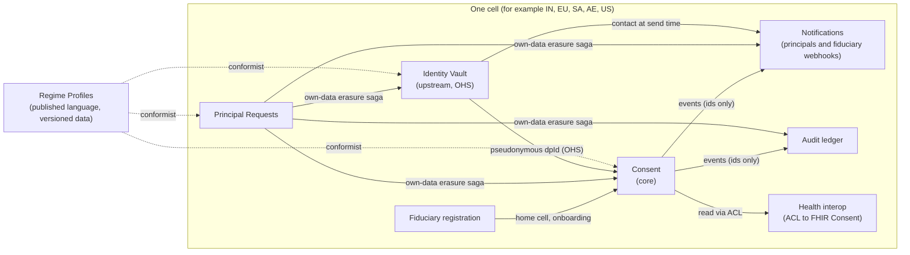
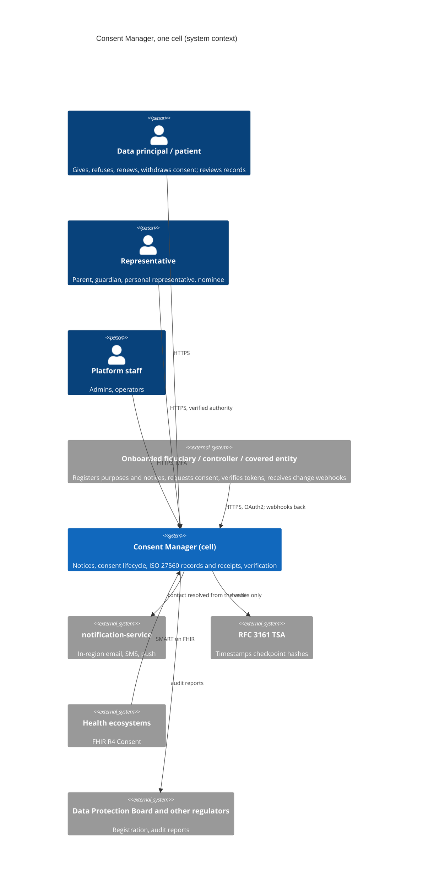

# A pure consent manager, to DPDPA, GDPR, HIPAA, the Gulf laws and ISO/IEC TS 27560

- **Status:** Proposed, for review
- **Date:** 2026-10-11
- **Decisions:** [ADR-018](../adr/adr-018-regional-cells-for-data-residency.md) to
  [ADR-025](../adr/adr-025-iso-27560-consent-records-and-receipts.md)

> This is an architecture input, not legal advice. Every statutory figure (ages, deadlines, retention periods) is held
> as versioned data in a regime profile, so counsel can correct it without a code change. Figures marked
> **[confirm]** came from secondary sources or are disputed, and must be checked against the primary text by counsel
> or the DPO before go-live.

## 1. What the platform is, and is not

**The platform is a consent manager, and only that.** DPDPA s.2(g) defines a consent manager as the principal's
single point of contact to give, manage, review and withdraw consent through an accessible, transparent and
interoperable platform.

- **India:** it applies for registration with the Data Protection Board under Rule 4 and meets the First Schedule.
- **The EU/UK, the US and the Gulf:** it is the consent-management platform that controllers, fiduciaries and covered
  entities use to collect and prove consent.

The same product does both, in one role. It acts for the principal, holds no stake in the fiduciaries, and never sees
the data the consents govern.

| In scope: consent management | Out of scope: not a consent manager's job |
|---|---|
| Showing a fiduciary's notice (versioned, in the principal's language) and recording that it was shown | Writing the fiduciary's notice or privacy policy |
| Consent requested, given, refused, partly given, renewed, modified, withdrawn, expired, for each purpose, never bundled | Processing, storing or routing the personal data the consent governs (DPDPA First Schedule Part B, item 2) |
| Consent for data to be shared between fiduciaries onboarded on the platform, and the record of that sharing | Moving the data itself between fiduciaries |
| Consent on behalf of a child or a person with a disability, by a verified parent or lawful guardian; HIPAA authorisations by a patient or personal representative | Any lawful basis other than consent: contract, legal obligation, legitimate interest, DPDPA "legitimate uses" |
| Tamper-proof consent records and receipts (ISO/IEC TS 27560), kept at least 7 years, given to the principal in machine-readable form | A fiduciary's records of processing, DPIAs, sub-processor or transfer registers |
| Telling fiduciaries at once when consent changes, and verifying a consent token's live status | A fiduciary's own breach response |
| The platform's own duties as a data fiduciary for its users' account data: their rights, its grievances, its breaches | Fulfilling access, erasure or correction of data a fiduciary holds |
| Relaying a principal's request about a fiduciary's data to that fiduciary, and recording it, where the law lets the principal use the consent manager for this **[confirm DPDPA Rule 14]** | Being the fiduciary's ticketing system for those requests |

**Success criteria:**

1. **Registration:** India's consent-manager registration can be applied for when Rule 4 opens (13/14 November 2026
   **[confirm]**), and the independent certification Part A item 9 requires can be passed.
2. **Records:** every consent record conforms to ISO/IEC TS 27560 and is issued to the principal as a receipt.
3. **Data-blind:** the platform can't read the personal data it consents about; its own data on principals is held in
   their jurisdiction and is erasable, subject to legal holds.
4. **Withdrawal:** withdrawing is as easy as giving, and takes effect on the next check.
5. **Variance:** a change in a law's figures ships as reviewed data, not code.

## 2. The standards it is built to

| Standard | What it governs here | Conformance |
|---|---|---|
| **DPDPA 2023 and DPDP Rules 2025**, First Schedule Parts A and B | The consent manager's role, registration conditions, its 13 obligations | Mapped item by item in §6.6 |
| **ISO/IEC TS 27560:2023**, consent record information structure | The consent record and receipt: Header, Notice, Processing, Parties, Events | Records and receipts conform; [ADR-025](../adr/adr-025-iso-27560-consent-records-and-receipts.md) |
| **W3C Data Privacy Vocabulary (DPV)** | The vocabulary of purposes, data categories, legal bases and consent states, and the JSON-LD form of 27560 records | Purposes and data categories map to DPV concepts |
| **ISO/IEC 29184:2020**, online privacy notices and consent | What a notice must say, and how consent is asked (clear, separate per purpose, no pre-ticked boxes) | DP portal and notice model follow it |
| **GDPR Art. 7 and EDPB Guidelines 05/2020 on consent** | Freely given, specific, informed, unambiguous; demonstrable; as easy to withdraw as to give | Granular, unbundled requests; proof in the record |
| **HIPAA §164.508** | The core elements and statements of an authorisation | Authorisation as a consent type; [ADR-024](../adr/adr-024-hipaa-authorisations-and-fhir-consent.md) |
| **HL7 FHIR R4 `Consent`**, and India's DEPA consent artefact | Exchanging consent with health ecosystems and India's account-aggregator and ABDM networks | Mappings at the boundary, never in the domain |
| **ISO/IEC 27001 and ISO/IEC 27701** | Information security and privacy management of the operator | Certification target for the operating company |
| **Board-published interoperability standards** | Part A item 9's certification | To adopt when the Board publishes them **[confirm status]** |

Out of scope on purpose: IAB TCF (advertising consent strings), because a pure consent manager acting for the
principal doesn't serve ad-tech consent chains.

## 3. Where the platform stands today

Ranked by severity:

| # | Gap | Standard or law | Severity | Evidence |
|---|---|---|---|---|
| G1 | **Principals' contact data in events and outbox rows.** `CnsReqCreatedEvt`, `CnsDeniedEvt` and `CnsNotificationFailedEvt` carry `dpRef` with the raw email or phone; Pulsar retains them, and the ledger copies payloads. | Erasure in every law; data minimisation | Critical | `cm-cns-cmd-dom` events, `cns_cmd.outbox_evt` |
| G2 | **No residency model.** One deployment holds every jurisdiction's principals. | DPDPA s.16, KSA PDPL transfers, UAE health data, GDPR Ch. V | Critical | `infra/docker-compose.yml` |
| G3 | **Records are not 27560 records.** Missing: notice version and language, controller and recipients, jurisdiction, rights, withdrawal method, event states such as renewed or lapsed. No receipt is issued. No machine-readable export for the principal. | ISO/IEC TS 27560, DPDPA First Schedule B3 and B4, GDPR Art. 7(1) | Critical | `cns_art` and the read model |
| G4 | **A revoked consent can still verify** for about a second (status read from an eventually consistent projection). | DPDPA s.6(4), GDPR Art. 7(3), HIPAA §164.508(b)(5) | High | `scripts/verify-phase1.sh` step 13; task filed |
| G5 | **Fiduciaries aren't told when consent changes.** They learn only if they verify. | DPDPA s.6(6) (fiduciary must stop on withdrawal), MeitY CMS BRD (propagation) | High | No webhook or event to fiduciaries |
| G6 | **Notices are unversioned and single-language;** purposes are free text, so purpose limitation isn't enforced, and requests aren't checked for bundling. | DPDPA s.5 and the Eighth Schedule, ISO/IEC 29184, GDPR Art. 7(2) | High | `cns_req.ntc_text`, `prps_code` |
| G7 | **No consent on behalf of others:** no parent, lawful guardian or HIPAA personal representative; no age threshold. | DPDPA s.9 and Rule 10, GDPR Art. 8, HIPAA §164.502(g) | High | None |
| G8 | **No HIPAA authorisation elements;** data categories have no sensitivity. | HIPAA §164.508(c) | High | `Scp`, `DCat` |
| G9 | **No renewal or re-confirmation, and no modification** (partial consent is planned). | 27560 event states, MeitY CMS BRD | Medium | Lifecycle has no renew or modify |
| G10 | **No consent for sharing between onboarded fiduciaries,** and no record of that sharing. | DPDPA First Schedule B1 and B3 | Medium | None |
| G11 | **The platform's own obligations aren't visible:** no public disclosure page (B11), no Board audit report (B12), no conflict-of-interest controls in the product (B9, B10). | DPDPA First Schedule | Medium | None |
| G12 | **Rights over the platform's own data:** principals can't download their records, correct their contact, or close their account with erasure; their requests to fiduciaries can't be relayed. | DPDPA ss.11-14, GDPR Arts. 15-20, Gulf laws | Medium | Only the ledger knows erasure |
| G13 | **Health-grade security baseline:** plain HTTP between services, single-factor staff sign-in, no record of staff reads. | HIPAA §164.312; proposed Security Rule | Medium | docker-compose, Keycloak flow |

Already aligned, and kept:
- Signed, purpose-bound consent artefacts verified at a PEP/PDP.
- A tamper-evident ledger with erasable payloads and RFC 3161 anchoring, which is what "tamper-proof records" needs
  (B3).
- Passwordless principals.
- Principals masked from staff.
- Least-privilege staff (ADR-017).
- Circuit breakers (ADR-016).
- No path by which the platform receives governed data.

## 4. Domain

### Subdomains

- **Core:** Consent: notices shown, requests, decisions, artefacts, records and receipts, verification, propagation.
  This is the whole product.
- **Supporting:**
  - Identity Vault (the platform's own data about principals and representatives)
  - Principal Requests (own-data rights, relayed requests, grievances about the platform)
  - Regime Profiles
  - Notifications
  - Billing
  - Audit ledger
  - Fiduciary registration
  - Platform staff
- **Generic:** authentication (Keycloak), delivery (notification-service), timestamping (TSA).

### Ubiquitous language (additions)

| Term | Meaning |
|---|---|
| **Consent record** | The ISO/IEC TS 27560 record of one consent: header, notice, processing, parties, events. The legal evidence. |
| **Consent receipt** | A copy of the consent record issued to the principal (and to the fiduciary), signed by the platform. |
| **Purpose definition** | A fiduciary's registered purpose: description, data categories with sensitivity and DPV mapping, retention, recipients, transfers, mandatory or optional, and localised notice versions. |
| **Notice version** | An immutable, hashed text of a purpose's notice in one language. |
| **Renewal** | The principal re-confirming a consent before it lapses (27560 "re-confirmed"). |
| **Sharing consent** | Consent for one onboarded fiduciary to share data with another; the data moves between them, never through the platform. |
| **Representative** | A parent, a lawful guardian, a HIPAA personal representative, or a DPDPA nominee, with verified authority. |
| **Regime, regime profile, cell, subject, subject key** | As in [ADR-018](../adr/adr-018-regional-cells-for-data-residency.md) to [ADR-020](../adr/adr-020-regime-profiles-as-versioned-data.md). |
| **Relayed request** | A principal's rights request about a fiduciary's data, passed to that fiduciary and recorded, but never fulfilled by the platform. |

### Bounded contexts

| Context | New or changed | Service | Personal data |
|---|---|---|---|
| Consent (write) | Changed: purpose definitions, notice versions, representatives, renewal, sharing consent, authorisation elements, 27560 records and receipts, change propagation | `cm-cns-cmd-svc` | Pseudonymous only |
| Consent (read) | Changed: projects new events, serves records and receipts, live status | `cm-cns-qry-svc` | Pseudonymous only |
| **Identity Vault** | **New** | `cm-vlt-svc` | Yes, encrypted per subject |
| **Principal Requests** | **New**, narrow | `cm-dsr-svc` | Pseudonymous, plus encrypted request text |
| Regime Profiles | New, as versioned data (`cm-reg-kit` and an OPA bundle) | n/a | No |
| Health interoperability | **New**, an anti-corruption layer | `cm-fhir-svc` | Pseudonymous; maps to FHIR `Consent` |
| Fiduciary registration | Changed: home cell; conflict-of-interest declarations | `cm-df-reg-svc` | Fiduciary contact persons only |
| Notifications | Changed: resolves contact from the vault at send time; fiduciary webhooks | `cm-ntf-svc` | Transient only |
| Audit, Platform staff, Billing | Small changes (staff MFA and access audit) | as today | as today |



### Key domain events (pseudonymous ids only)

- **Consent:**
  - `PurposeDefined`, `NoticeVersionPublished`
  - `CnsReqCreated` (`dpId`, `noticeVersionId`, `language`, `representativeId?`)
  - `CnsGranted`, `CnsPartiallyGranted`, `CnsDenied`, `CnsRenewed`, `CnsModified`, `CnsRevoked`, `CnsExpired`,
    `CnsNotificationFailed`
  - `SharingConsentGranted` / `Revoked`
  - `ReceiptIssued`
- **Vault:** `SubjectRegistered`, `ContactPointVerified`, `RepresentationGranted` / `Revoked`, `SubjectShredded`.
- **Requests:** `RequestReceived`, `RequestRelayedToFiduciary`, `OwnDataRequestFulfilled`, `ErasureCompleted`.

## 5. Drivers and options

**Quality attribute scenarios** (ISO/IEC 25010):

| Attribute | Scenario | Measure |
|---|---|---|
| Compliance: withdrawal | A principal withdraws | The next verification returns DENY: 0 ms stale window; the fiduciary's webhook is delivered or retried, with evidence |
| Compliance: records | Any consent event | A 27560 record exists, validates against the schema in CI, and is in the hash chain |
| Security: confidentiality | Any store, log, event or backup of a cell, queried from another cell | 0 records reachable; CI isolation probe |
| Compliance: erasure (own data) | A principal closes their account | Contact data unreadable everywhere within 24 h (estimate; the strictest regime figure governs); legal-hold records stay pseudonymised |
| Maintainability | Counsel changes a regime figure | A reviewed data change, no code change |
| Neutrality | A fiduciary asks for principals' data or analytics beyond their own consents | Impossible by API design; nothing exposes cross-fiduciary data |

**Top drivers:**
1. Conformance of consent records (27560 and the DPDPA First Schedule).
2. Residency.
3. Erasability of the platform's own data, with legal holds.

**Fitness functions:**
- 27560 JSON-schema validation of every record type in CI.
- An event-schema test: no contact fields.
- ArchUnit: contact-data types only in `cm-vlt-*`.
- The cross-cell isolation probe.
- The existing clean-architecture rules.

**Options for residency.** The same comparison as before applies: regional cells beat a geo-partitioned global
deployment, and a product per country.
- **Why cells win:** residency holds for every store, topic, log and backup by construction, and India's registration
  expects an Indian operator.
- **The strongest case for the runner-up:** one global deployment is cheaper and gives one account per person.
- **What would change the recommendation:** serving only regimes with no localisation.

## 6. Design

The views are drawn twice:
- in Mermaid, here
- as draw.io files in [diagrams/](diagrams/):
  - [C4 context](diagrams/c4-context.drawio)
  - [C4 containers of one cell](diagrams/c4-container-cell.drawio)
  - [context map](diagrams/context-map.drawio)
  - [cell deployment](diagrams/deployment-cells.drawio)
  - [own-data erasure saga](diagrams/erasure-saga.drawio)



### 6.1 Consent records and receipts ([ADR-025](../adr/adr-025-iso-27560-consent-records-and-receipts.md))

- **Every consent produces an ISO/IEC TS 27560 record**, assembled by the read side from the write side's events and
  the purpose definition.
  - **Header:** schema version, record id, subject (`dpId`).
  - **Notice:** notice version id, its hash, its language.
  - **Processing:** purposes, personal data categories with DPV types, sensitivity, recipients, controller (the
    fiduciary), legal basis (consent), jurisdiction, storage and retention, transfers, how to withdraw, rights.
  - **Parties:** principal (pseudonymous), representative, fiduciary, the platform.
  - **Events:** time, actor, type (expressed or explicit), state (given, refused, renewed, modified, withdrawn, lapsed,
    terminated by the controller), validity.
- **Serialisation:** JSON-LD with DPV, validated in CI.
- **Receipts:**
  - issued to the principal on every state change, and downloadable
  - offered to the fiduciary through the API
  - signed with the platform's key, the same JWKS as consent tokens (ADR-013)
- **Retention:** records live in the ledger (tamper-proof, B3) for the regime's retention: 7 years for DPDPA consent
  managers **[confirm]**, 6 years for HIPAA authorisation documentation. Erasure of the subject shreds the
  identifying parts only (ADR-019).
- **Export:** the principal can download all their records and receipts as machine-readable JSON-LD, and as PDF (B4).

### 6.2 Asking for consent properly

- **Purpose definitions:** a fiduciary registers each purpose.
  - Contents: description, data categories (DPV-mapped, with sensitivity `ORDINARY` / `SENSITIVE` / `PHI` / `CHILD`),
    mandatory or optional, retention, recipients, transfers, and flags (`TRACKING`, `BEHAVIOURAL_MONITORING`,
    `TARGETED_ADVERTISING`).
  - A request must name registered purposes and may only ask for their categories (purpose limitation).
- **Notice versions:** immutable and hashed, one per language. Any DPDPA Eighth Schedule language at the principal's
  choice, Arabic with RTL, EU languages. Notice content follows ISO/IEC 29184 (who, what, why, how long, to whom, how
  to withdraw, rights, how to complain).
- **No bundling:**
  - each purpose is consented to separately
  - optional purposes are never pre-ticked
  - a request that bundles an optional purpose into a mandatory one is refused
  - partial consent records exactly the categories granted
- **Renewal and modification:** a principal can renew before a consent lapses, or change which categories it covers.
  Both are 27560 events.
- **Sharing consent:** a principal can consent to fiduciary A sharing named categories with onboarded fiduciary B for
  a purpose. The platform records the consent and issues a token both can verify. The data moves A to B directly,
  never through the platform (B1, B2, B3).

### 6.3 Withdrawal and change propagation

- **The status check reads the write side** (or a revocation set written in the same transaction as the revoke),
  behind a fail-closed breaker. That closes G4; it is the task already filed, which records its own ADR.
- **Fiduciaries get a signed webhook** on every state change of their consents (granted, modified, renewed,
  withdrawn, expired, lapsed), with at-least-once delivery from the outbox, retries and a delivery record (G5). The
  webhook carries ids and states, never personal data.

### 6.4 Consent on behalf of others ([ADR-022](../adr/adr-022-children-guardians-and-representatives.md))

- **Who:** a parent or lawful guardian for a child, or for a person with a disability; a HIPAA personal
  representative; a DPDPA nominee on death or incapacity.
- **What is recorded:** verified authority from the regime profile's accepted methods, recorded on the record's
  Parties.
- **Children:** requests for a child are refused when a purpose is flagged `TRACKING`, `BEHAVIOURAL_MONITORING` or
  `TARGETED_ADVERTISING` (DPDPA s.9(3)), within the exemptions the profile lists.

### 6.5 HIPAA authorisations ([ADR-024](../adr/adr-024-hipaa-authorisations-and-fhir-consent.md))

- **When:** a PHI purpose under the HIPAA regime makes the request an authorisation.
- **What it must carry:** the §164.508(c) elements and statements, an expiry date or event, and a step-up signing
  ceremony.
- **FHIR:** `cm-fhir-svc` exposes records as FHIR R4 `Consent`, and maps the DEPA consent artefact for India. FHIR and
  DEPA stay at the boundary.

### 6.6 DPDPA First Schedule, Part B, item by item ([ADR-023](../adr/adr-023-pure-consent-manager-boundary-and-neutrality.md))

| Item | Obligation | How the platform meets it |
|---|---|---|
| B1 | Enable consent to onboarded fiduciaries, directly or through a fiduciary holding the data | Consent lifecycle; sharing consent (§6.2) |
| B2 | Personal data flowing through is not readable by the consent manager | No API accepts governed data; tokens carry ids and categories only; fitness function on API schemas |
| B3 | Record consents given, denied and withdrawn, notices, and sharing | 27560 records in the hash-chained ledger (§6.1) |
| B4 | Principal access, machine-readable copies, at least 7 years | Export and receipts; retention in the regime profile |
| B5 | A website or app as the primary means of access | DP portal (web; mobile app later) |
| B6 | No subcontracting or assignment of obligations | Every obligation is met by the platform's own services. Hosting and delivery vendors are processors under contract, not delegates of the obligation **[confirm with counsel]**. |
| B7 | Reasonable security safeguards | §6.8 baseline; ISO/IEC 27001 |
| B8 | Fiduciary capacity towards principals | The product acts only on the principal's instruction; no feature serves a fiduciary against a principal |
| B9, B10 | No conflicts of interest with fiduciaries, their promoters or key people | Fiduciaries get no cross-fiduciary data, no analytics on principals, no ranking or advertising. Staff declare interests, kept in `cm-stf-svc`. Billing is per transaction, never per consent outcome. |
| B11 | Public disclosure of ownership and interests | A public "About this consent manager" page, generated from a reviewed disclosure file |
| B12 | Audit mechanisms, periodic report to the Board | A Board report generated from the ledger and controls evidence; scheduled per the regime profile |
| B13 | No change of control without Board approval | Corporate, not product; noted in the operating runbook |

### 6.7 The platform's own data about principals ([ADR-019](../adr/adr-019-identity-vault-and-crypto-shredding.md), [ADR-021](../adr/adr-021-principal-requests-own-data-and-relay.md))

- **Identity Vault:** contact points, names, dates of birth and representatives live only in `cm-vlt-svc`, encrypted
  with a per-subject key. Everything else uses `dpId`. Notifications resolve contact at send time.
- **Principal Requests (`cm-dsr-svc`):**
  - **Own-data rights:** access (all records and receipts), correction (contact points), erasure (close the account).
  - **Erasure:** an ordered saga that ends with shredding the subject key. Legal holds keep the pseudonymised consent
    records.
  - **Relay:** a principal's request about a fiduciary's data is passed to that fiduciary (webhook and DF app) and
    recorded, never fulfilled by the platform.
  - **Grievances:** grievances about the platform itself are handled to the regime deadline.
- **Its own breaches:** an internal incident runbook with the regime profile's clocks, for breaches of the platform's
  own data only.

```mermaid
sequenceDiagram
  autonumber
  participant P as Principal (DP portal)
  participant REQ as cm-dsr-svc (orchestrator)
  participant REG as Regime profile
  participant CNS as Consent
  participant DF as Fiduciaries
  participant NTF as cm-ntf-svc
  participant KC as Keycloak
  participant AUD as cm-aud-svc
  participant VLT as cm-vlt-svc
  P->>REQ: close my account and erase my data
  REQ->>REG: deadline, legal holds
  REQ->>P: notice of erasure (DPDPA 48 h [confirm])
  REQ->>CNS: withdraw active consents; keep pseudonymised records under hold
  CNS-->>DF: change webhooks (withdrawn)
  REQ->>NTF: delete push devices
  REQ->>AUD: erase payloads and subject links
  REQ->>KC: delete login account
  Note over REQ: point of no return
  REQ->>VLT: shred subject key
  VLT-->>REQ: SubjectShredded
  REQ->>P: confirmation (contact captured before shredding, then discarded)
```

### 6.8 Residency and security ([ADR-018](../adr/adr-018-regional-cells-for-data-residency.md))

- **Cells:** a cell per jurisdiction (IN, EU, SA, AE, US; Qatar, Bahrain and Oman when needed). A cell is every
  service, store, key, backup and provider in one region. Only images, IaC, regime data, anonymous counts and
  timestamp hashes cross cells.
- **Security baseline:**
  - mTLS between services; encryption at rest
  - staff MFA (passkey, or TOTP fallback)
  - step-up for HIPAA signing
  - every staff read of principal-level data written to the ledger
  - scoped Keycloak service accounts
  - OWASP ASVS L2 (L3 for the vault)
  - ISO/IEC 27001 and 27701 as the operator's management systems

### 6.9 Threats (STRIDE, summary)

| Flow | Threat | Control |
|---|---|---|
| Fiduciary resolves "by email" to `dpId` | **I**nformation disclosure (account enumeration) | Always returns a `dpId`; rate-limited; audited |
| Receipts | **T**ampering, **R**epudiation | Signed receipts; records in the anchored hash chain |
| Representative consent | **S**poofing a parent | Profile-defined verification methods; evidence by reference |
| Fiduciary webhooks | **S**poofing the platform; replay | Signed payloads with timestamp and id; fiduciary verifies against the JWKS |
| Neutrality | A fiduciary obtaining others' data through the platform | No cross-fiduciary API; per-tenant authorisation at the PEP |

## 7. Risks

| Risk | Likelihood | Impact | Mitigation |
|---|---|---|---|
| The Board's interoperability standard (Part A item 9) differs from 27560 | Medium | High | Records are built from a neutral domain model; 27560, FHIR and DEPA are mappings, and another can be added |
| Regime figures wrong or outdated | Medium | High | Profiles as data with source and `confirmed`; DPO review |
| Registration timing (mid-November 2026) and Board readiness | High | High | Phase 0 below first; the Board's state is outside our control **[confirm]** |
| Hosting or delivery vendors read as subcontracting obligations (B6) | Low | High | Counsel's opinion; vendors contracted as processors only |
| Erasure saga stuck | Medium | High | `STUCK` state, alerts, runbook, evidence |
| Clear PII left somewhere | Medium | Critical | Fitness functions, log deny-list, PII scans in staging |
| Cost of several cells | High | Medium | Identical IaC; add cells only for a tenant who needs one |

**Open questions for counsel or the DPO:**
- every **[confirm]**
- whether DPDPA Rule 14 lets principals exercise rights through the consent manager, and how
- B6 and vendors
- whether the UK shares the EU cell
- per-cell health implementation guides

## 8. Plan

The core domain comes first. India's date sets Phase 0. Findings from the design review (Appendix B) are folded in.

| Phase | Scope | Closes |
|---|---|---|
| **0: Registration readiness (India)** | Short-lived tokens, revocation status list and live status (R1, R2); immediate withdrawal; fiduciary webhooks; immutable purpose versions with re-consent (R4); multilingual versioned notices, no bundling, deceptive-design rules (R7); accessible DP portal (R6); write-side 27560 records, receipts with their own key and trusted time, export (R5, R8); duration from purpose and renewal (R9); partial consent; 7-year retention with legal hold; pseudonymous events; disclosure page; Board report v1 | G1 (partly), G3, G4, G5, G6, G9, G11; R1, R2, R4-R9 |
| **1: Own data** | Identity Vault with crypto-shredding; Principal Requests (own-data rights, relay, grievances); regime profiles in `cm-reg-kit` and OPA, with applicable-regime sets (R3); fiduciary verification at onboarding (R11); contracts (R15); termination flows (R16) | G1, G12; R3, R11, R15, R16 |
| **2: Cells** | Cell IaC, cell directory, second cell (EU, with member-state profiles), isolation probe; WORM archive, RPO and RTO, restore drills (R18) | G2; R18 |
| **3: Health** | HIPAA authorisations with an e-signature ceremony (R13), PHI sensitivity, `cm-fhir-svc` (FHIR R4 Consent), staff MFA and access audit, mTLS; US cell | G8, G13; R13 |
| **4: Representatives, sharing, Gulf** | Parents, guardians, nominees, majority re-confirmation (R12); sharing consent with both parties notified (R10); evidence of expression (R17); consent-manager portability (R14); Arabic and RTL; SA and AE cells | G7, G10; R10, R12, R14, R17 |

**First spike:** a 27560 record and signed receipt for one consent, generated from today's events and validated
against the schema, plus a pseudonymous `CnsReqCreatedEvt`. It proves the record model and the hardest data change on
the existing stack.

## Appendix A: Regime starting figures

For counsel to confirm. Each becomes a regime-profile entry with its source, and `confirmed: false` until signed off.
Only figures a consent manager needs are listed.

| Item | DPDPA | GDPR | HIPAA | KSA PDPL | UAE PDPL | DIFC / ADGM | QA / BH / OM |
|---|---|---|---|---|---|---|---|
| Platform's role | Registered Consent Manager | Consent platform; processor for controllers, controller of its account data | Business associate | Processor | Processor | Processor | Processor |
| Child / capacity | Under 18 (s.2(f)) | Under 16; member states may lower to 13 (Art. 8) | Personal representative per state law | **[confirm]** | **[confirm]** | **[confirm]** | **[confirm]** |
| Consent records kept | At least 7 years (First Schedule B4) | As long as needed to prove consent | 6 years (§164.530(j)) | **[confirm]** | **[confirm]** | **[confirm]** | **[confirm]** |
| Withdrawal | As easy as giving (s.6(4)) | As easy as giving (Art. 7(3)) | In writing; effective except where relied on (§164.508(b)(5)) | **[confirm]** | **[confirm]** | **[confirm]** | **[confirm]** |
| Own-data access request | **[confirm Rule 14]** | 1 month, +2 (Art. 12(3)) | n/a (BA) | **[confirm]** | **[confirm]** | **[confirm]** | **[confirm]** |
| Grievance about the platform | 90 days **[confirm]** | n/a (complaint to the authority) | n/a | **[confirm]** | **[confirm]** | **[confirm]** | **[confirm]** |
| Own breach to regulator | Without delay; detail within 72 h **[confirm]**; CERT-In 6 h | 72 h (Art. 33) | To the covered entity per the BAA | 72 h **[confirm]** | **[confirm]** | **[confirm]** | **[confirm]** |
| Erasure notice | 48 h before (Rule 8(2)) **[confirm]** | n/a | n/a | **[confirm]** | **[confirm]** | n/a | **[confirm]** |
| Notice languages | English or any Eighth Schedule language, the principal's choice | The subject's language, plainly | Plain language | Arabic **[confirm]** | Arabic **[confirm]** | English | Arabic **[confirm]** |
| Cross-border | Negative list (s.16) | Ch. V | BAA flow-down | Adequacy or safeguards; risk assessment for sensitive data | **[confirm]**; health data localised **[confirm]** | Adequacy or safeguards | **[confirm]** |

**Sources consulted (secondary unless stated; for orientation only):**
- [DPDP Rules 2025, First Schedule (dpdpa.com)](https://www.dpdpa.com/schedule/schedule1.html)
- [DPDP Rules 2025, all rules and dates](https://dpdpa.dcomply.in/rules/)
- [Consent managers under the DPDP Rules (Mondaq)](https://www.mondaq.com/india/data-protection/1832140/building-the-consent-layer-consent-managers-under-the-dpdp-rules-2025)
- [MeitY's BRD for consent management (PwC)](https://www.pwc.in/research-insights/news_alert/regulatory-insights/business-requirement-document-for-consent-management-under-the-dpdp-act.html)
- [Designing consent management systems under the DPDP Act (Lexology)](https://www.lexology.com/library/detail.aspx?g=ced020a3-8c96-4401-a00e-bc4feab1c812)
- [ISO/IEC TS 27560 with DPV (W3C DPV Community Group)](https://w3c-cg.github.io/dpv/guides/consent-27560)
- [Implementing ISO/IEC TS 27560 for GDPR and DGA](https://arxiv.org/pdf/2405.04528)
- [HIPAA Security Rule overhaul status (Alston & Bird)](https://www.alston.com/en/insights/publications/2025/11/hipaa-security-rule-overhaul)
- [Saudi cross-border transfers (King & Spalding)](https://www.kslaw.com/news-and-insights/international-personal-data-transfers-under-saudi-arabias-data-protection-law)
- [UAE data protection law (DLA Piper)](https://www.dlapiperdataprotection.com/countries/uae-general/law.html)

## Appendix B: Design review against the standards (2026-10-11)

A second pass over this design, read against:
- the DPDPA definition and First Schedule
- ISO/IEC TS 27560 (as profiled by W3C DPV)
- ISO/IEC 29184
- GDPR Art. 7 and 8 with EDPB guidance
- HIPAA §164.508
- WCAG 2.2
- India's 2023 guidelines on dark patterns

Each finding is something the design above gets wrong or leaves out. Resolutions are folded into the plan (§8);
R1 and R2 and R4 to R9 go into Phase 0. Findings are ranked by severity.

### Critical

| # | Finding | Standard | Resolution |
|---|---|---|---|
| R1 | **A withdrawn consent stays verifiable offline for up to a year.** Tokens carry the artefact's validity as `exp` (365 days by default, `ApproveCnsCmdHandler.DEFAULT_VALIDITY`), and the JWKS is published for fiduciaries to verify tokens themselves (ADR-013). §6.3 fixes the live status check, but not a fiduciary that checks only the signature. | DPDPA s.6(4), (6); GDPR Art. 7(3); HIPAA §164.508(b)(5); MeitY CMS BRD (instant propagation) | Separate **token lifetime** (short: minutes to hours, from the regime profile) from **consent validity**. Tokens are refreshed through the status API. Publish a per-cell **revocation status list** (W3C Bitstring Status List) with a bounded cache age for offline checks. The onboarding terms oblige a status check before each use; webhooks speed things up, they don't replace the check. A new ADR supersedes the token lifetime in ADR-006 and ADR-013. |
| R2 | **The trade-off between availability and immediate withdrawal is not designed.** Verification sits on every fiduciary's data path, and §6.3 fails closed, so an outage of a cell's consent manager stops its fiduciaries processing. No SLO, topology or staleness bound is stated. | DPDPA s.6(4) against B7 (reasonable safeguards); ISO/IEC 25010 availability | State a verification SLO (99.95% per cell is an estimate to validate). Serve status from a replicated revocation set, updated in the revoke's transaction, with read replicas per availability zone. Staleness is bounded by the token lifetime and status-list age from R1. The fail-closed or fail-open choice per regime and purpose is recorded in the regime profile; health defaults to closed. |
| R3 | **The applicable law is assumed to be the cell's.** One consent can fall under several regimes at once: GDPR reaches an EU resident dealing with an Indian fiduciary; HIPAA sits beside US state law; DIFC and ADGM tenants sit inside the UAE. GDPR is not one profile either: the digital-consent age varies by member state, 13 to 16. 27560 allows several jurisdictions on a record (Jurisdiction is 1..*). | GDPR Art. 3 and 8(1); 27560 §8.3 Jurisdiction | Each consent gets a set of **applicable regimes**, derived from the fiduciary's establishment, the principal's residence or targeting, and the purpose's sector. Rules compose **strictest wins** per item (age, duration, withdrawal, retention). Member-state profiles (`GDPR_DE`, `GDPR_FR`, …) and `UK_GDPR` are separate. The set is recorded on the 27560 record. ADR-020 is amended. |
| R4 | **No rule for changing a purpose after consent.** Notices are versioned, but the design doesn't say what happens to existing consents when a purpose's description, categories, recipients, retention or transfers change. | GDPR Art. 5(1)(b), 6(4), 7; DPDPA s.6(1) (specified purpose); ISO/IEC 29184 (notice of changes) | Purpose definitions are **immutable versions**. A consent stays bound to the version it was given for. A material change (new purpose, more categories, new recipients, longer retention, a new transfer) needs **re-consent**: the old consent keeps covering only what it covered. A non-material change (wording) notifies principals. The version is on the 27560 record. |
| R5 | **Where the authoritative consent record lives is inconsistent.** §6.1 has the read side (eventually consistent, rebuildable) assemble records, and says records "live in the ledger". But the ledger holds hashes of events and erasable payloads, not 27560 records. A 7-year, tamper-proof record store isn't designed. | DPDPA First Schedule B3, B4; 27560 §10.1 (integrity); GDPR Art. 7(1) | The **consent record is owned by the Consent write side**: an append-only document updated in the same transaction as each state change, its every version hashed into the ledger. The read side serves copies only. Long-term retention moves to an in-cell, object-locked (WORM) archive. ADR-025 is amended. |

### High

| # | Finding | Standard | Resolution |
|---|---|---|---|
| R6 | **Accessibility is missing.** DPDPA defines the consent manager as an **accessible** platform, and principals include persons with disabilities. | DPDPA s.2(g); WCAG 2.2 AA; EN 301 549 (EU); Section 508 (US); India's GIGW | WCAG 2.2 AA for the DP portal, notices and receipts (receipts as tagged PDF/UA as well as JSON-LD), screen-reader-tested consent flows, automated checks (axe) in CI plus manual audits, and an assisted channel. |
| R7 | **Deceptive design isn't addressed** beyond pre-ticked boxes and bundling. | India's CCPA Guidelines on Dark Patterns (2023); EDPB Guidelines 03/2022; GDPR Art. 7(4) "freely given"; ISO/IEC 29184 | The consent decision is always rendered by the platform's own components, never styled by the fiduciary. Rules: accept and refuse have equal prominence and effort; withdrawal takes no more steps than giving; no confirm-shaming; no repeated asking (a refused request can't be re-raised for a period the regime profile sets); no false urgency. UI tests enforce the rules. |
| R8 | **Receipts and records must verify for 7 years or more,** but receipts are signed with the token key (ADR-025), keys rotate (ADR-013), and receipts carry no trusted time. | 27560 §10.1; DPDPA B3, B4; GDPR Art. 7(1) | A separate receipt-signing key. Retired public keys stay published, so the key history is permanent. Each receipt gets trusted time, by RFC 3161, or by inclusion in an anchored ledger checkpoint with a proof (ADR-015). A crypto-period and algorithm-migration plan. |
| R9 | **Consent validity is a fixed 365 days in code.** 27560 treats endless duration as invalid in several jurisdictions and expects renewal; validity should follow the purpose and the law. | 27560 §8.5 duration; GDPR Art. 5(1)(e); HIPAA §164.508(c)(1)(v) (expiry date or event) | Duration comes from the purpose definition, bounded by the strictest applicable regime's maximum (R3). Lapse becomes a recorded event. Principals are prompted to renew before a lapse. HIPAA authorisations may expire on an event. |
| R10 | **Withdrawing a sharing consent doesn't name who must stop.** §6.2 lets A share with B, and §6.3 webhooks "fiduciaries", but B, the recipient, also holds the data. Sharing across cells is undefined. | DPDPA First Schedule B1, B3; DPDPA s.6(6); GDPR Art. 17(2), 19 | Both A and B are recipients on the 27560 record and get change webhooks and status. Sharing is within a cell unless a lawful transfer mechanism is recorded on the purpose. |
| R11 | **Fiduciaries are onboarded without verification.** Principals rely on the platform for who is asking; an unverified requester is a phishing route against the people the platform acts for. | DPDPA First Schedule B8 (fiduciary capacity), Part A item 8 | Verify each fiduciary's legal identity at onboarding, with registry checks by cell: CIN and GSTIN in India, trade licence in the UAE, CR in Saudi Arabia, EIN and NPI for US covered entities. Requests show "verified". Suspension on fraud terminates its pending requests (R16). |
| R12 | **The representative lifecycle stops at the grant.** A child turning 18 (or the GDPR age) should confirm consents a parent gave; a guardianship can end; a nominee's trigger needs evidence. | DPDPA s.9; GDPR Art. 8; EDPB Guidelines 05/2020 on consent (reaching the age of consent) | Majority is a scheduled event from the date of birth held in the vault. It asks the now-adult principal to confirm or withdraw each consent given for them. Representations carry an end date and are re-checked. |
| R13 | **Electronic signatures on HIPAA authorisations aren't designed** beyond step-up sign-in. A valid authorisation needs a signature, and in the US an electronic one has its own conditions. | HIPAA §164.508(c)(1)(vi); US ESIGN Act and state UETA **[confirm]** | A signing ceremony: disclosure and consent to electronic records, a clear act of intent, the signature bound to the exact authorisation text and version, and a copy to the patient (§164.508(c)(4)). |

### Medium

| # | Finding | Standard | Resolution |
|---|---|---|---|
| R14 | **No way for a principal to move to another consent manager.** DPDPA requires an interoperable platform; export exists, but there's no import or transfer. | DPDPA s.2(g), First Schedule Part A item 9 | Transfer and import based on 27560 receipts. Adopt the Board's standard when published. |
| R15 | **No contract strategy for the APIs, events and webhooks fiduciaries build against.** | Interoperability (Part A item 9); 27560 schema versioning | Contract-first. OpenAPI for APIs, AsyncAPI for webhooks and events. A pinned JSON-LD context version for 27560. A signed-webhook specification. A deprecation policy, and consumer-driven contract tests. |
| R16 | **"Terminated by controller" and "invalidated by authority" are listed (ADR-025) but have no flows:** a fiduciary leaves or is suspended, or a regulator orders consents void. | 27560 §8.5 states; DPDPA ss.27-28 (Board directions) | Define both flows: mass termination, principals told, webhooks sent, and the reason on each record. |
| R17 | **What evidence of the expression is captured isn't defined.** The record requires who expressed consent and recommends recording how. The device and IP address are personal data. | 27560 §8.5 (expression by entity, method); data minimisation | Record the consent component and its version, the channel, the authentication assurance level and the representative. Capture IP or device only where a regime requires it, encrypted in the vault. |
| R18 | **Durability and recovery are unquantified** for 7-year records. | DPDPA B4, B7; HIPAA §164.308(a)(7) | RPO and RTO per cell (estimates to validate: RPO ≤ 5 min, RTO ≤ 4 h). An in-cell WORM archive. Restore drills that re-apply the shredded-subjects list. |

### What the review didn't change

- The boundary of a pure consent manager (ADR-023).
- Regional cells (ADR-018).
- The vault with crypto-shredding (ADR-019).
- Regime profiles as reviewed data (ADR-020, amended by R3).
- Representatives (ADR-022, extended by R12).
- HIPAA and FHIR at the boundary (ADR-024, extended by R13).
