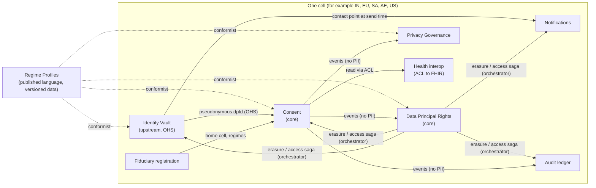
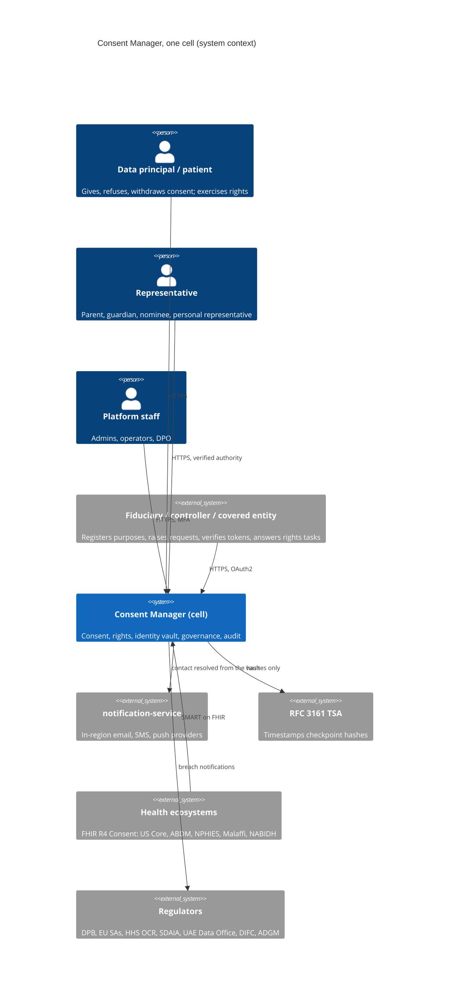
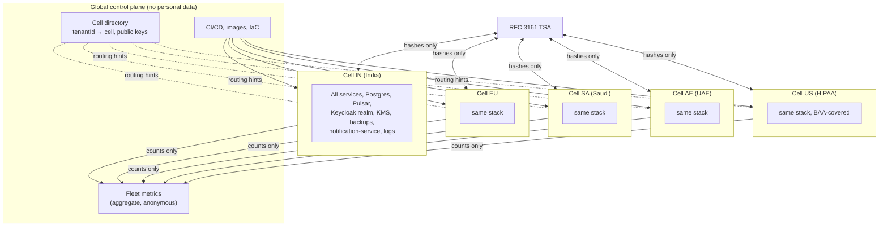
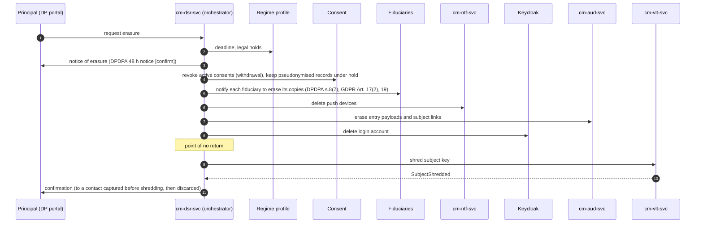

# Privacy compliance architecture: DPDPA, GDPR, HIPAA and the Middle East

- **Status:** Proposed, for review
- **Date:** 2026-10-11
- **Decisions:** [ADR-018](../adr/adr-018-regional-cells-for-data-residency.md) to
  [ADR-024](../adr/adr-024-hipaa-authorisations-and-fhir-consent.md)

> This is an architecture input, not legal advice. Every statutory figure below (ages, deadlines, retention periods)
> is held as versioned data in a regime profile so counsel can correct it without a code change. Figures marked
> **[confirm]** came from secondary sources or are disputed, and must be checked against the primary text by counsel
> or the DPO before go-live.

## 1. Problem

The platform has to operate lawfully in four regimes at once:

- **India:** as a Consent Manager registered with the Data Protection Board.
- **The EU/UK:** as a consent-management platform for controllers.
- **The US:** as a HIPAA business associate holding patients' authorisations.
- **The Gulf:** as a processor for controllers in the UAE (federal, DIFC, ADGM), Saudi Arabia, Qatar, Bahrain and
  Oman.

It must hold each principal's data where their law wants it and honour their rights in every regime, without forking
the product per country.

**Success criteria:**

1. **India first:** the platform can apply for Consent Manager registration when Rule 4 opens (13/14 November 2026
   **[confirm date]**).
2. **No personal data crosses a residency boundary** it must not cross, including in events, logs and backups.
3. **Every data-principal right** in scope can be fulfilled end to end within the strictest applicable deadline, with
   evidence.
4. **Erasure is complete:** after erasure, no copy of a principal's contact data remains readable anywhere, including
   immutable logs and backups, except what a law requires to be kept, and that is pseudonymised.
5. **A change in a law's figures** (an age, a deadline, a retention period) ships as reviewed data, not code.

**Stakeholders:**
- Data principals and data subjects (they are also patients under HIPAA).
- Data fiduciaries, controllers and covered entities (the platform's tenants).
- Platform operations and the DPO.
- Regulators: Data Protection Board of India, EU and UK supervisory authorities, HHS OCR, SDAIA, the UAE Data Office,
  DIFC and ADGM commissioners, Qatar's NCGAA, Bahrain's PDPA and Oman's MTCIT **[confirm authorities]**.

**Out of scope:**
- Processing the data the consents govern. The platform never receives it, and must not (DPDPA First Schedule,
  Part B: a consent manager must not be able to read the data it routes).
- Legal registration filings themselves.
- Being a FHIR clinical data repository.

## 2. Where the platform stands today

The consent core, identity, audit and resilience patterns are strong. The gaps are in data-subject rights, data
location and what the platform's events and stores carry. Ranked by severity:

| # | Gap | Regimes | Severity | Evidence in the code |
|---|---|---|---|---|
| G1 | **Principals' contact data in events and outbox rows.** `CnsReqCreatedEvt`, `CnsDeniedEvt` and `CnsNotificationFailedEvt` carry `dpRef` with the raw email or phone. Pulsar retains them, and the audit ledger copies payloads. Erasure can't reach them. | All | Critical | `cm-cns-cmd-dom` events, `cns_cmd.outbox_evt.payload_json` |
| G2 | **No data-principal rights workflow** (access, correction, erasure, portability, nomination, grievance, objection, restriction) and no deadline tracking. The ledger supports erasure; nothing triggers it across services. | All | Critical | Only `cm-aud-svc` knows erasure |
| G3 | **No residency model.** One database, one event bus and one Keycloak realm hold every principal, whatever their law. | DPDPA s.16, KSA PDPL transfers, UAE health data, GDPR Ch. V | Critical | `infra/docker-compose.yml` |
| G4 | **A revoked consent can still verify** for about a second (status read from an eventually consistent projection). | DPDPA s.6(4), GDPR Art. 7(3), HIPAA §164.508(b)(5) | High | Seen in `scripts/verify-phase1.sh` step 13; task already filed |
| G5 | **Notices are unversioned and single-language.** The artefact doesn't record which text, in which language, the principal saw. | DPDPA s.5 and the Eighth Schedule languages, GDPR Art. 7(1) proof, Arabic for the Gulf | High | `cns_req.ntc_text` |
| G6 | **No retention schedule.** Nothing expires records by law. DPDPA needs 7-year consent records for a consent manager; HIPAA 6 years for authorisations; GDPR storage limitation the reverse. | All | High | No retention job |
| G7 | **No children, guardians or representatives.** No age threshold, no verifiable parental consent, no lawful guardian for persons with disabilities, no HIPAA personal representative. | DPDPA s.9, GDPR Art. 8, HIPAA §164.502(g), UAE and KSA PDPL | High | None |
| G8 | **No HIPAA authorisation elements** (recipient, expiry event, statements, signature) and no PHI classification of data categories. | HIPAA §164.508 | High | `Scp`/`DCat` are plain codes |
| G9 | **Consent is the only lawful basis.** Purposes aren't registered, so purpose limitation can't be enforced, and processing under contract, legal obligation or legitimate uses can't be shown to principals. | GDPR Art. 6, DPDPA s.7, UAE and KSA PDPL | Medium | `prps_code` is free text |
| G10 | **No breach register or notification clock.** | GDPR Art. 33/34, DPDPA s.8(6), HIPAA §164.400-414, KSA, UAE, DIFC, ADGM | Medium | None |
| G11 | **Transport and staff authentication fall short of the health baseline:** plain HTTP between services, single-factor staff sign-in, no record of staff reads. | HIPAA §164.312, the proposed Security Rule (encryption, MFA) | Medium | docker-compose, Keycloak flow |
| G12 | **No records of processing, sub-processor register or transfer register.** | GDPR Art. 28/30, KSA, DIFC | Low | None |

Already aligned, and kept:
- Purpose-bound signed consent artefacts, enforced at a PEP/PDP.
- A tamper-evident ledger with erasable payloads and RFC 3161 anchoring (ADR-014, ADR-015). Only hashes leave the
  platform.
- Passwordless principals.
- Principals pseudonymised to staff (`DpPseudonym`).
- Least-privilege staff roles (ADR-017).
- Circuit breakers (ADR-016).

## 3. Domain analysis

### Subdomains

- **Core:** Consent (lifecycle, artefacts, verification) and Data Principal Rights. Rights fulfilment is what a
  registered consent manager is judged on.
- **Supporting:** Purpose and Notice catalogue, Identity Vault (contact data, representatives), Regime Profiles,
  Privacy Governance (breaches, records of processing, sub-processors), Notifications, Billing, Audit.
- **Generic:** authentication (Keycloak), message delivery (notification-service), timestamping (TSA).

### Ubiquitous language (additions)

| Term | Meaning |
|---|---|
| **Regime** | A body of data protection law with its own rules: `DPDPA`, `GDPR`, `UK_GDPR`, `HIPAA`, `UAE_PDPL`, `DIFC_DPL`, `ADGM_DPR`, `KSA_PDPL`, `QA_PDPPL`, `BH_PDPL`, `OM_PDPL`. |
| **Regime profile** | The versioned, effective-dated figures and switches of one regime: digital-consent age, notice languages, right deadlines, breach clocks, retention, transfer rules, required consent elements. |
| **Cell** | One complete, independent deployment of the platform's data plane in one jurisdiction. Personal data never leaves its cell. |
| **Subject** | A data principal, data subject or patient, as held by the Identity Vault: a pseudonymous `dpId` with encrypted contact points. |
| **Subject key** | The data-encryption key that seals one subject's personal data wherever it is stored. Destroying it erases the data (crypto-shredding). |
| **Representative** | A person who may act for a subject, with evidence and scope: a parent or lawful guardian, a DPDPA nominee, a HIPAA personal representative. |
| **Purpose definition** | A fiduciary's registered purpose: lawful basis per regime, data categories with sensitivity, retention, recipients, transfers, and localised notice versions. |
| **Lawful basis** | Why processing is lawful: consent, contract, legal obligation, vital interests, public task, legitimate interests (GDPR), or a "certain legitimate use" (DPDPA s.7). Only consent needs the principal's act. |
| **Rights request** | A subject's request to access, correct, erase, port, nominate, object, restrict or complain, with a deadline from the regime profile. |
| **Legal hold** | A reason a record must be kept despite erasure: DPDPA consent records for 7 years, HIPAA authorisation documentation for 6 years, or a legal claim. What is held is pseudonymised. |
| **HIPAA authorisation** | A consent whose purpose definition is health-related and requires the §164.508(c) elements. |
| **Incident** | A suspected or confirmed personal data breach, with one notification clock per regime and recipient. |

### Bounded contexts and context map

| Context | New or changed | Service | Holds personal data? |
|---|---|---|---|
| Consent (write) | Changed: purpose catalogue, notice versions, representatives, authorisation elements, pseudonymous refs only | `cm-cns-cmd-svc` | Pseudonymous only |
| Consent (read) | Changed: projects new events | `cm-cns-qry-svc` | Pseudonymous only |
| **Identity Vault** | **New** | `cm-vlt-svc` | **Yes**, encrypted per subject |
| **Data Principal Rights** | **New** | `cm-dsr-svc` | Pseudonymous, plus encrypted request text |
| **Privacy Governance** | **New** | `cm-gov-svc` | Counts and pseudonyms; no contact data |
| Regime Profiles | New, as versioned data (`cm-reg-kit` and an OPA bundle), not a service | n/a | No |
| Fiduciary registration | Changed: home cell, regimes served | `cm-df-reg-svc` | Fiduciary contact persons only |
| Notifications | Changed: resolves contact points through the vault at send time | `cm-ntf-svc` | Transient only |
| Audit | Unchanged design; records the new events | `cm-aud-svc` | Erasable payloads |
| Platform staff | Changed: MFA, access logging | `cm-stf-svc` | Staff only |
| Health interoperability | **New**, an anti-corruption layer | `cm-fhir-svc` | Pseudonymous; maps to FHIR |

### Key domain events (all carry pseudonymous ids only)

- **Vault:** `SubjectRegistered`, `ContactPointVerified`, `RepresentationGranted` / `Revoked`, `SubjectShredded`.
- **Consent:** `PurposeDefined` / `Versioned`, `NoticeVersionPublished`, `CnsReqCreated` (now `dpId`, `noticeVersion`,
  `language`, `representativeId?`), `CnsGranted`, `CnsPartiallyGranted`, `CnsDenied`, `CnsRevoked`, `CnsExpired`,
  `CnsNotificationFailed`.
- **Rights:** `RightsRequestReceived`, `IdentityVerified`, `RequestRoutedToFiduciary`, `RequestFulfilled` /
  `Refused` / `Extended`, `ErasureCompleted`.
- **Governance:** `IncidentOpened`, `IncidentClassifiedAsBreach`, `NotificationDue`, `NotificationSent`,
  `IncidentClosed`.

## 4. Requirements and drivers

**Functional:** everything in G1 to G12, plus partial consent (already planned), which GDPR's granularity and HIPAA's
"description of the information" need anyway.

**Quality attribute scenarios** (ISO/IEC 25010):

| Attribute | Scenario | Measure |
|---|---|---|
| Security: confidentiality | An operator in cell IN queries any store, log, event or backup of cell EU | 0 records reachable; enforced by network and IAM, tested in CI with a cross-cell probe |
| Compliance: erasure | A subject's erasure is approved | Contact data unreadable in every store within 24 h of approval (estimate; the strictest regime figure governs); evidence record produced |
| Compliance: withdrawal | A subject revokes a consent | The next verification after the revoke call returns DENY: 0 ms stale window |
| Compliance: timeliness | A rights request is received | 100% fulfilled or extended with notice before the regime deadline; alert at 50% and 80% of the window |
| Maintainability | Counsel changes a regime figure | Shipped as a reviewed data change, no code change; effective-dated |
| Availability | A cell's region fails | Other cells unaffected; recovery within the cell's RPO and RTO, without leaving the jurisdiction |

**Top three drivers:**

1. **Residency and sovereignty:** personal data stays in its jurisdiction, including events, logs and backups.
2. **Erasability with retention:** rights must work across immutable logs while legal holds keep pseudonymised
   records.
3. **Regime variance without forks:** one codebase whose behaviour follows versioned regime data.

**Fitness functions (CI):**
- An ArchUnit rule: no class outside `cm-vlt-*` may declare contact-data types.
- An event-schema test: no event schema contains `email`, `phone`, `name` or `ExtDpRef` fields.
- A cross-cell isolation probe.
- A rights-deadline monitor in staging.
- The existing clean-architecture rules.

## 5. Options

| | **A. Regional cells + Identity Vault + regime profiles** | B. One global deployment, geo-partitioned data | C. A product per jurisdiction |
|---|---|---|---|
| Residency (driver 1) | Strong: everything, including the event bus, logs, backups and IdP, is in-region | Weak: the event bus, logs, IdP and backups stay global unless each is also partitioned; hard to prove | Strong |
| Erasure with retention (2) | Strong: crypto-shredding with a per-subject key, in-cell KMS | Possible, but key management spans regions | Strong, if each fork does it |
| Regime variance (3) | One codebase plus regime data | One codebase plus regime data | Copies diverge |
| Complexity | Medium: N copies of one stack, run by IaC | High: geo-partitioned DB and bus, cross-region consistency | Very high over time |
| Cost | N times the infrastructure floor (estimate: each cell is a minimal HA footprint) | Lowest infrastructure | Highest people cost |
| Operability | Deploy and observe N cells; a failure stays in its cell | One blast radius | N teams |
| Lock-in | Low: any cloud with an in-country region | High: needs a geo-partitioned database product | Low |
| Compliance fit | Best fit for DPDPA consent-manager registration and Gulf health localisation | Fails Gulf health localisation; weak for India | Good, but costly |

**Recommendation: A.** It is the only option where residency holds for every byte by construction, not by
configuration of each store.

**What would change it:** if the platform served only regimes with an adequacy or SCC route and no localisation, for
example EU, UK and US only, B's lower cost would win.

**Best case for B:** cells multiply fixed cost and operational toil. A tenant serving principals in two regimes needs
two tenancies, and a person with relationships in two cells has two accounts. B gives one account per person and one
place to operate.

These are real costs. We accept them because a breach of localisation is unrecoverable, and the duplication is
bounded: cells are identical, built by the same IaC and pipeline.

## 6. Design

The views are drawn twice:
- in Mermaid, here
- as draw.io files in [diagrams/](diagrams/):
  - [C4 context](diagrams/c4-context.drawio)
  - [C4 containers of one cell](diagrams/c4-container-cell.drawio)
  - [context map](diagrams/context-map.drawio)
  - [cell deployment](diagrams/deployment-cells.drawio)
  - [erasure saga](diagrams/erasure-saga.drawio)

### 6.1 Regional cells ([ADR-018](../adr/adr-018-regional-cells-for-data-residency.md))

- **A cell is the whole data plane:** every service, Postgres, Pulsar, the Keycloak realm, KMS keys, the
  notification-service instance and its providers, logs, traces and backups, all in one jurisdiction's region. Gulf
  health data goes to in-country regions.
- **A tenant (a fiduciary) is created in one cell** and serves the principals of that cell's regimes. A multinational
  has one tenancy per cell; the cell directory maps the tenant to its cells.
- **A principal belongs to a cell.** Their DP portal URL and identity are per cell. A person with relationships in two
  cells has two accounts (the accepted cost in §5).
- **What crosses cells:** images, IaC, regime-profile data, aggregate anonymous metrics, and RFC 3161 hash anchoring.
  Nothing else; enforced by network policy and tested in CI.
- **Cell map (initial):**
  - IN: DPDPA.
  - EU: GDPR. The UK can share the EU cell via the UK adequacy route **[confirm]**, or have its own.
  - SA: KSA PDPL.
  - AE: UAE PDPL. DIFC and ADGM tenants also run here, with their regime profiles.
  - US: HIPAA.
  - Qatar, Bahrain and Oman: their own cells when a tenant needs them; until then, no principals from those countries.

### 6.2 Identity Vault and crypto-shredding ([ADR-019](../adr/adr-019-identity-vault-and-crypto-shredding.md))

- `cm-vlt-svc` is the only holder of subjects' contact points (email, phone), names, dates of birth and
  representatives. Everyone else holds `dpId`.
- A fiduciary raising a request "by email" calls the vault (through the gateway). The vault returns, or creates, a
  pseudonymous `dpId` for that contact point, in the fiduciary's cell.
- Each subject has a **subject key** (a DEK), wrapped by the cell's KMS key. Personal fields are encrypted with it in
  the vault, and wherever any other store must keep a personal value. The value then travels as ciphertext plus key id,
  never in clear.
- **Erasure destroys the subject key.** Every ciphertext copy becomes unreadable: outbox rows, Pulsar topics, audit
  payloads, backups. Live rows are deleted as well.
- Notifications resolve contact points from the vault at send time, so the notify command carries `dpId` only (fixes
  G1).
- Keycloak keeps its login identity (email or phone), because sign-in needs it. Erasure deletes the Keycloak user, and
  Keycloak's own backups are covered by the cell's backup-expiry policy (§6.6).

### 6.3 Regime profiles ([ADR-020](../adr/adr-020-regime-profiles-as-versioned-data.md))

- **What it is:** a versioned, effective-dated document per regime in `cm-reg-kit` (JSON plus a typed Java API),
  also published as an OPA data bundle for the PDP.
- **What it holds:**
  - digital-consent age
  - accepted notice languages
  - required consent elements
  - lawful bases offered
  - each right's deadline and extension rule
  - breach clocks per recipient
  - retention per record class, and legal holds
  - transfer rules
  - representative types
- Code asks the profile, for example `profile(KSA_PDPL, at).rightDeadline(ACCESS)`, and never hard-codes a figure.
- Changes are pull requests reviewed by the DPO (CODEOWNERS), with a CI check that every figure cites its source and
  carries a `confirmed` flag.

**Starting figures:** every one needs counsel's confirmation before it is relied on. Appendix A lists them with their
sources and confidence.

### 6.4 Consent changes

- **Purpose definitions:** a new aggregate in the Consent context. A fiduciary registers purposes (code, description,
  lawful basis per regime, data categories with sensitivity `ORDINARY` / `SENSITIVE` / `PHI` / `CHILD`, retention,
  recipients, cross-border transfers). A consent request must name a registered purpose, and may only ask for that
  purpose's categories (purpose limitation, G9).
- **Notice versions:** each purpose has immutable, hashed notice versions per language (any of the DPDPA Eighth
  Schedule languages, Arabic with RTL, EU languages). The artefact records `noticeVersionId`, `language` and the hash
  of what was shown (G5).
- **Non-consent bases:** a purpose registered under contract, legal obligation, legitimate interest or a DPDPA
  legitimate use needs no request. It is shown to the principal in the DP portal ("Acme processes your … because …"),
  and the rights in §6.5 apply to it.
- **Withdrawal takes effect at once (G4):** the verification status check reads the write side, or a revocation set
  written in the same transaction as the revoke, behind a fail-closed breaker. This is the task already filed, and
  it records its own ADR.
- **Partial consent:** already planned. The artefact records the categories granted.
- **Representatives (G7, [ADR-022](../adr/adr-022-children-guardians-and-representatives.md)):**
  - If the subject is under the regime's digital-consent age, or has a lawful guardian on record, the request goes to
    the representative.
  - Their verified authority (method, evidence reference, scope, validity) is recorded on the artefact.
  - Under DPDPA, verification can use identity and age details the fiduciary already holds, a virtual token from an
    authorised entity, or a DigiLocker credential **[confirm against Rule 10]**.
  - Requests for children are refused when they involve tracking, behavioural monitoring or targeted advertising
    (DPDPA s.9(3)), enforced by purpose-definition flags.
- **HIPAA authorisations (G8, [ADR-024](../adr/adr-024-hipaa-authorisations-and-fhir-consent.md)):** a PHI purpose
  makes the request a HIPAA authorisation. It must carry the §164.508(c) core elements and statements:
  - description of the information
  - who discloses it, and to whom
  - the purpose
  - an expiry date or event
  - the right to revoke, and how
  - whether treatment is conditioned on signing
  - the potential for redisclosure
  - signature and date, or a representative's authority

  These are validated by the regime profile. `cm-fhir-svc` exposes artefacts as FHIR R4 `Consent` resources (and
  accepts them) at the boundary; the domain model stays FHIR-free.

### 6.5 Data principal rights ([ADR-021](../adr/adr-021-data-principal-rights-and-erasure-saga.md))

- **`cm-dsr-svc`** owns `RightsRequest`.
- **Invariants:**
  - The deadline is fixed from the regime profile at receipt.
  - Fulfilment needs a verified identity: the signed-in principal, or a representative with authority.
  - Every refusal cites a legal ground.
  - Extensions are only those the regime allows, and the principal is told.
- **Access and portability:** assembles what the platform holds (consents, history, notices shown, representatives)
  as JSON and PDF, and as FHIR `Consent` for health. It routes a request for the fiduciary's own data to that
  fiduciary as a task (DF app and API webhook) and tracks the answer to the deadline.
- **Correction:** of contact points, in the vault, after re-verification.
- **Nomination (DPDPA s.14):** a nominee is a representative effective on death or incapacity.
- **Grievance:** a first-class request with the regime's deadline **[confirm DPDPA figure]**, and escalation
  information (the Board, the supervisory authority).
- **Erasure saga** (orchestrated, forward-recovering: shredding can't be undone, so every reversible step happens
  first):

- **Saga behaviour:**
  - Each step is idempotent and retried with backoff. A step that can't complete puts the request in `STUCK` with an
    alert; it never silently skips.
  - Legal holds (DPDPA's 7-year consent records, HIPAA's 6-year documentation, a legal claim) keep the pseudonymised
    consent record and stop at removing contact data. The principal is told which records are held, why and until
    when.
  - Fiduciaries' confirmations are tracked separately, so their delay doesn't block the platform's own erasure.

### 6.6 Retention and deletion

- **One retention job per context** reads the regime profile: record class → period → action (delete, pseudonymise,
  shred).
- **Pulsar:** topic retention is shortened to what replay needs (days), and since events carry no clear PII after G1,
  what remains is pseudonymous.
- **Backups:** in-cell, encrypted, and expiring by the strictest erasure period. Restores re-apply a "shredded subjects"
  tombstone list before serving.
- **Logs:** no PII by policy (structured logging with a deny-list filter). DPDPA Rule 8(3)'s one-year minimum log
  retention applies **[confirm]**.

### 6.7 Privacy Governance ([ADR-023](../adr/adr-023-breach-response-and-privacy-governance.md))

- **`cm-gov-svc`** keeps the incident register. An incident has clocks per regime and recipient, computed from the
  regime profile:
  - GDPR Art. 33: 72 h to the authority.
  - DPDPA Rule 7: the Board without delay, a detailed report within 72 h **[confirm]**; CERT-In within 6 h.
  - HIPAA: individuals without unreasonable delay, at most 60 days; HHS within 60 days if 500 or more people;
    business associate to covered entity per the BAA.
  - Saudi, UAE, DIFC, ADGM, Qatar, Bahrain, Oman: per their profiles **[confirm]**.
- It produces notification drafts per recipient, and tracks sent evidence and closure.
- **It also keeps:**
  - records of processing (from purpose definitions and the platform's own processing)
  - the sub-processor register (cloud, notification providers, TSA)
  - transfer impact records (Saudi risk assessments)
  - DPIAs
- Tenants' breaches, which they report to the platform as their processor, and the platform's own breaches flow
  through the same register.

### 6.8 Security baseline (G11)

- **mTLS between services.** Service mesh or Spring SSL bundles, cell-scoped CA.
- **TLS at the edge.** Encrypted volumes and database at rest, plus application-level encryption of personal fields
  (vault).
- **Staff sign-in gets a second factor:** WebAuthn passkey, or TOTP as fallback. That satisfies HIPAA's proposed MFA
  requirement and good practice either way.
- **Principals keep one-time-code sign-in.** For HIPAA health consents, step-up to a passkey or a verified second
  channel before signing an authorisation.
- **Every staff read of principal-level data** (the masked consent list, rights requests) is written to the audit
  ledger as an access event (HIPAA §164.312(b)).
- **Keycloak admin calls move to scoped service accounts** (follow-up from ADR-017).
- **OWASP ASVS L2** as the verification baseline, L3 for the vault.

### 6.9 Threat model, critical flows (STRIDE, summary)

| Flow | Threat | Control |
|---|---|---|
| Fiduciary resolves "by email" to `dpId` | **I**nformation disclosure: enumerating whether a person has an account | The vault returns a `dpId` whether or not the person is known (creates on first use), rate-limited per fiduciary, audited |
| Erasure | **R**epudiation by the platform, **T**ampering with evidence | Every step is written to the ledger; RFC 3161-anchored completion record |
| Representative consent | **S**poofing a parent | Verification method and evidence reference recorded; regime-defined acceptable methods only |
| Cross-cell | **I**nformation disclosure through shared services | No shared data plane; probe in CI |
| Staff console | **E**levation | Role split (ADR-017), MFA, access audit |

## 7. Risks

| Risk | Likelihood | Impact | Mitigation |
|---|---|---|---|
| Regime figures wrong or outdated | Medium | High | Profiles as data with source and `confirmed` flag; DPO review; quarterly legal refresh |
| India registration timing (Rule 4, mid-November 2026) | High | High | Phase 0 below targets registration evidence first; the Board's readiness is outside our control **[confirm Board status]** |
| Erasure saga stuck at a step | Medium | High | `STUCK` state, alerts at 50% and 80% of the deadline, runbook, manual completion with evidence |
| Crypto-shredding misses a clear copy | Medium | Critical | Event-schema and ArchUnit fitness functions; log deny-list; periodic PII scan of stores and topics |
| Cost and toil of five or more cells | High | Medium | Identical IaC, one pipeline, fleet dashboards; add cells only when a tenant needs one |
| Person with accounts in two cells confused | Medium | Low | Clear per-cell portals; DP portal states its jurisdiction |
| FHIR mapping drift | Low | Medium | FHIR validator in CI against the chosen IGs |
| Vault becomes a bottleneck or single point of failure | Medium | High | Stateless API, HA Postgres, read cache of `dpId` existence only; circuit breaker with fail-closed for writes |

**Open questions for counsel or the DPO:**
- Every **[confirm]** figure, and Appendix A.
- Whether the UK shares the EU cell.
- Whether Saudi principals' non-health data may be served from the AE cell under Saudi transfer safeguards. The
  default is no: a separate SA cell.
- HIPAA: whether the platform signs BAAs as a business associate only, or also acts for health plans.

## 8. Plan

The core domain comes first. India's deadline sets Phase 0.

| Phase | Scope | Closes |
|---|---|---|
| **0: India consent-manager readiness** | Immediate withdrawal; purpose definitions and versioned, multilingual notices; 7-year consent-record retention with legal hold; DP portal history of every consent and notice; pseudonymous events (vault-lite: `dpId` in events, contact data encrypted); breach register v1 | G4, G5, G1 (partly), G9, G10 (partly), part of G6 |
| **1: Rights** | `cm-dsr-svc` with access, correction, grievance, nomination, erasure saga; regime profiles in `cm-reg-kit` and OPA; full Identity Vault with crypto-shredding | G2, G1, G6 |
| **2: Cells** | IaC for a cell; cell directory; second cell (EU); isolation probe | G3 |
| **3: Health** | HIPAA authorisations, PHI classification, `cm-fhir-svc` (FHIR R4 Consent), MFA and access audit, mTLS; US cell | G8, G11 |
| **4: Gulf and children** | Representatives and verifiable parental consent; Arabic and RTL in all three frontends; SA and AE cells | G7, rest of G3 |
| **5: Governance completeness** | Records of processing, sub-processor and transfer registers, DPIA records | G12 |

**First spike:** a pseudonymous `CnsReqCreatedEvt` with the contact point resolved by a minimal vault, end to end
through notification. It proves the hardest structural change (G1) on the existing stack before building the rest.

## Appendix A: Regime starting figures

Starting figures only, for counsel to confirm. Each becomes a regime-profile entry with source and `confirmed: false`
until signed off.

| Item | DPDPA | GDPR | HIPAA | KSA PDPL | UAE PDPL | DIFC / ADGM | QA / BH / OM |
|---|---|---|---|---|---|---|---|
| Platform's role | Consent Manager (registered) | Processor for controllers; controller for its account data | Business associate | Processor | Processor | Processor | Processor |
| Digital-consent age | Under 18 is a child (s.2(f)) | 16, member states may lower to 13 (Art. 8) | Personal representative per state law | Guardian for those lacking capacity **[confirm]** | **[confirm]** | **[confirm]** | **[confirm]** |
| Access request | Rules: **[confirm]** | 1 month, +2 (Art. 12(3)) | 30 days, +30 (§164.524) | **[confirm]** | **[confirm]** | **[confirm]** | **[confirm]** |
| Grievance | 90 days **[confirm, Rule numbering disputed]** | n/a (complaint to the authority) | n/a | **[confirm]** | **[confirm]** | **[confirm]** | **[confirm]** |
| Breach to regulator | Without delay; detail within 72 h **[confirm]**; CERT-In 6 h | 72 h (Art. 33) | ≤ 60 days (500 or more), else annually | 72 h **[confirm]** | **[confirm]** | DIFC as soon as practicable; ADGM 72 h **[confirm]** | **[confirm]** |
| Consent records kept | 7 years (consent manager, First Schedule Part B) **[confirm]** | As long as needed to prove consent | 6 years (§164.530(j)) | **[confirm]** | **[confirm]** | **[confirm]** | **[confirm]** |
| Erasure notice | 48 h before erasure (Rule 8(2)) **[confirm]** | n/a | n/a | **[confirm]** | **[confirm]** | n/a | **[confirm]** |
| Cross-border | Negative list (s.16, Rule 15) | Adequacy, SCCs, BCRs (Ch. V) | No restriction; BAA flow-down | Adequacy or safeguards; risk assessment for sensitive data | **[confirm]**; UAE health data localised (Federal Law 2 of 2019) **[confirm]** | Adequacy or safeguards | **[confirm]** |
| Notice languages | English or any Eighth Schedule language, at the principal's choice | Clear and plain, in the subject's language | Plain language | Arabic **[confirm]** | Arabic **[confirm]** | English | Arabic **[confirm]** |

**Sources consulted (secondary unless stated; for orientation only):**
- [DPDP Rules 2025, all rules and effective dates](https://dpdpa.dcomply.in/rules/)
- [Consent managers under the DPDP Rules 2025 (Mondaq)](https://www.mondaq.com/india/data-protection/1832140/building-the-consent-layer-consent-managers-under-the-dpdp-rules-2025)
- [Schedule 1, DPDP Rules 2025](https://www.dpdpa.com/schedule/schedule1.html)
- [Data breach reporting timeline of the DPDP Rules (MediaNama)](https://www.medianama.com/2025/11/223-data-breach-reporting-timeline-of-dpdp-rules-2025-explained/)
- [KPMG: DPDP Rules 2025 guidance](https://assets.kpmg.com/content/dam/kpmgsites/in/pdf/2025/11/dpdp-rules-2025-guidance-to-dpdp-act-implementation.pdf)
- [HIPAA Security Rule overhaul status (Alston & Bird)](https://www.alston.com/en/insights/publications/2025/11/hipaa-security-rule-overhaul)
- [HIPAA updates 2026 (HIPAA Journal)](https://www.hipaajournal.com/hipaa-updates-hipaa-changes/)
- [Saudi cross-border transfers (King & Spalding)](https://www.kslaw.com/news-and-insights/international-personal-data-transfers-under-saudi-arabias-data-protection-law)
- [Saudi transfer framework (Dentons)](https://www.dentons.com/en/insights/alerts/2025/may/15/saudi-arabias-framework-for-cross-border-data-transfers)
- [UAE data protection law (DLA Piper)](https://www.dlapiperdataprotection.com/countries/uae-general/law.html)
