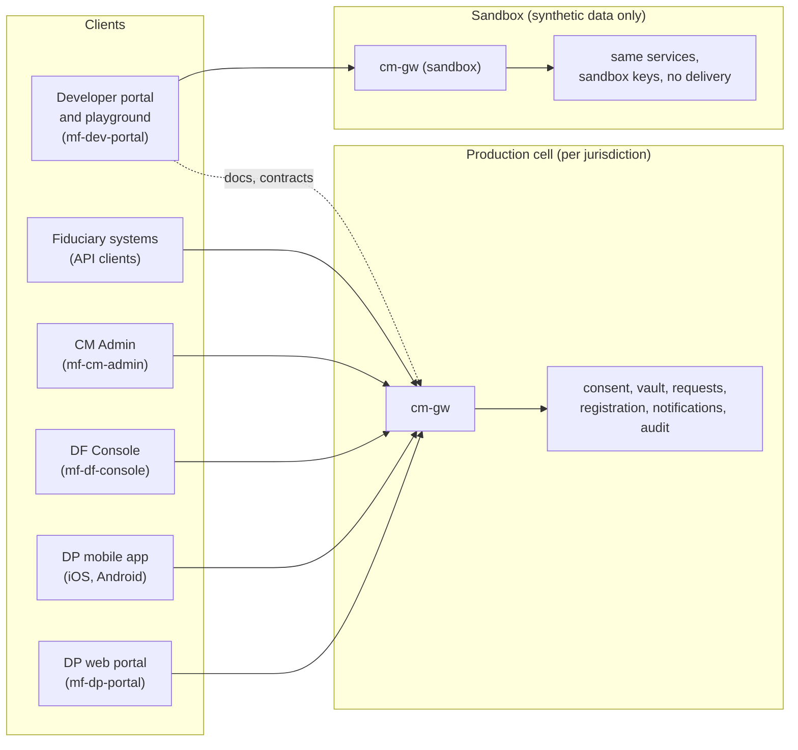

# Product architecture: what the consent manager offers, to whom, and through which channels

- **Status:** Proposed, for review
- **Date:** 2026-10-11
- **Builds on:** the [compliance architecture](../compliance/compliance-architecture.md) (what the platform may and
  must do) and ADRs 018-031
- **Decisions:** [ADR-032](../adr/adr-032-channels-per-audience-web-mobile-console-developer-portal.md),
  [ADR-033](../adr/adr-033-fiduciary-staff-accounts-separate-from-api-clients.md),
  [ADR-034](../adr/adr-034-sandbox-and-api-playground.md)

## 1. The product in one table

A pure consent manager (ADR-023) serves three audiences, plus its own staff:

| Audience | Channel | What it's for |
|---|---|---|
| **Data principals** (and their representatives) | **DP web portal** and **DP mobile app** (iOS and Android) | Review, give, refuse, partly give, adjust, renew and withdraw consent; see every record and receipt; act for a child or a person they represent; send requests about their data to a fiduciary; manage their own account |
| **Data fiduciaries' people** | **DF Console** (web) | Define purposes and notices; raise consent requests (one, or many); watch outcomes on a dashboard; manage webhooks, API clients and their team |
| **Data fiduciaries' systems** | **DF API** (REST) and **webhooks** | Raise requests, verify and refresh consent tokens, read status lists, fetch records and receipts, receive changes |
| **Developers at fiduciaries** | **Developer portal** with a **sandbox and API playground** | Learn the API, try every call against a sandbox with synthetic principals, simulate principals' decisions, inspect webhooks, download SDKs and contracts |
| Platform staff | CM Admin (web) | Onboard and verify fiduciaries, plans, operators (ADR-017, ADR-029) |

Every channel is a client of the same services through the gateway. No channel holds logic the others need, so a
rule, such as "never re-ask after a refusal", holds everywhere (ADR-028).

## 2. Data principal: web portal and mobile app

### 2.1 Journeys

| Journey | What the principal can do | Standards and decisions it satisfies |
|---|---|---|
| **Sign in** | Email or mobile one-time code; passkey (and biometric unlock on mobile) once enrolled | ADR-008; WCAG 2.2 accessible authentication |
| **Inbox** | See pending requests from verified fiduciaries, newest first, with the fiduciary's verified legal name and logo | ADR-029 (verified name); ADR-028 |
| **Decide** | Read the notice in their language. Then, per purpose: give, refuse, or give only some categories. Choose the validity (default: requested; never above the maximum). See the consequence of refusing each necessary category. | ISO/IEC 29184; GDPR Art. 7; DPDPA s.5, s.6; ADR-026, ADR-028, ADR-031 |
| **My consents** | Every consent, grouped by fiduciary: what it covers, until when, its status | DPDPA s.2(g) "manage, review" |
| **Change** | Shorten, end early, withdraw a category or the whole consent; renew before a lapse | DPDPA s.6(4); ADR-026 |
| **Sharing** | See and withdraw consents for one fiduciary to share with another | DPDPA First Schedule B1; ADR-031 |
| **History and receipts** | A timeline of every event; download signed receipts (JSON-LD and accessible PDF); export everything | ISO/IEC TS 27560; DPDPA First Schedule B3, B4; ADR-025 |
| **Acting for someone** | Switch to "acting for" a child or a represented person; the same journeys, recorded with their authority | DPDPA s.9; GDPR Art. 8; HIPAA §164.502(g); ADR-022 |
| **Coming of age** | A principal who becomes an adult confirms or withdraws consents given for them | ADR-022 |
| **HIPAA authorisation** | Read the full text, the e-signature disclosure, then sign with a step-up | HIPAA §164.508; ESIGN and UETA; ADR-024 |
| **Requests and grievances** | Send a request about their data to a fiduciary (relayed); complain about the platform; track both | ADR-021; DPDPA s.13 |
| **My account** | Contact points, language, notification channels, the platform's own privacy notice, close the account (erasure) | ADR-019, ADR-021, ADR-023 |

### 2.2 Channel rules

- **Same capabilities on web and mobile.** Neither channel is a reduced version of the other. DPDPA First Schedule B5
  makes a website or app the primary means of access; offering both is the principal's choice.
- **Accessibility:** WCAG 2.2 AA on the web, and the platform accessibility services on mobile (VoiceOver, TalkBack,
  dynamic type). Arabic right-to-left on both (ADR-028).
- **The decision screen comes from one shared component specification**, implemented once per platform and tested
  against the same deceptive-design rules (ADR-028).

### 2.3 Mobile specifics ([ADR-032](../adr/adr-032-channels-per-audience-web-mobile-console-developer-portal.md))

- **Push:** new requests, renewals due, and changes made elsewhere arrive as push notifications through
  notification-service's FCM provider (FCM covers APNs). A notification carries the title only, never notice text or
  personal data. Taps open the app, which fetches the details.
- **Local storage:**
  - Tokens and keys live in the platform's secure storage (Keychain, Android Keystore).
  - Downloaded receipts are stored encrypted, so they're available offline.
  - Nothing else is cached.
- **Integrity:** the app checks it is genuine (App Attest, Play Integrity) before high-assurance actions such as
  signing a HIPAA authorisation. A rooted or jailbroken device can still review consents, but can't sign.
- **Cells:** one app, many regions. The app asks for the principal's region at first launch and talks only to that
  cell's endpoints (ADR-018). Switching regions means a separate account, as on the web.

## 3. Data fiduciary: Console, API and webhooks

### 3.1 DF Console journeys

| Journey | What fiduciary staff can do | Decision |
|---|---|---|
| **Sign in** | As themselves (one-time code or the organisation's SSO), with MFA. Never with the API client secret. | [ADR-033](../adr/adr-033-fiduciary-staff-accounts-separate-from-api-clients.md) |
| **Team** | Invite colleagues with roles: Owner, Administrator, Consent manager, Developer, Auditor or DPO | ADR-033 |
| **Purposes and notices** | Define purposes (categories mapped to DPV, sensitivity, necessary flags with consequences, retention, recipients, transfers, requested and maximum validity). Write notices per language. Publish versions. The platform says whether a change is material and needs re-consent. | ADR-026, ADR-031 |
| **Raise requests** | One request; or many from a CSV upload; or re-consent for a new purpose version. Each request is checked against purpose limitation, bundling and the re-ask period before it's sent. | ADR-028, ADR-031 |
| **Dashboard** | Requests sent, pending, given, refused, partly given, withdrawn, lapsed, failed to reach; time to decide; renewals due; per purpose and over time. Counts only, never principals' identities beyond their own requests. | ADR-023 (neutrality) |
| **Consents** | Look up a consent by id: its record, history and receipts | ADR-025 |
| **Webhooks** | Register endpoints, see deliveries and retries, replay a failed delivery, rotate the signing secret | ADR-030 |
| **API clients** | Create, scope and rotate machine credentials (`private_key_jwt` preferred) | ADR-033 |
| **Relayed requests** | Principals' requests about the fiduciary's data, with deadlines, answered here or through the API | ADR-021 |
| **Organisation** | Verified legal profile, logo, DPO, plan and usage | ADR-029 |

### 3.2 DF API (contract-first, ADR-030)

| Area | Operations |
|---|---|
| Purposes | Create, version, publish, list; notice versions per language |
| Requests | Raise (single and batch), cancel a pending one, get status |
| Consents | Get record and receipts; refresh token; live status |
| Status | Per-fiduciary revocation status list (ADR-027) |
| Webhooks | Endpoint management; deliveries; replay |
| Relay | List and answer relayed requests |

All of it is in OpenAPI 3.1. Webhooks are in AsyncAPI 3, with signatures, ids and timestamps. SDKs are generated from
the contracts (TypeScript, Java and Python at first).

## 4. Developer portal, sandbox and API playground ([ADR-034](../adr/adr-034-sandbox-and-api-playground.md))

| Feature | What it does |
|---|---|
| **Docs** | Guides per journey; the OpenAPI and AsyncAPI references; changelog and deprecations |
| **Sandbox** | A separate environment with **synthetic principals only**: sandbox API clients, sandbox signing keys whose tokens are never valid in production, no real notifications, and no billing |
| **Playground** | Try any API call in the browser against the sandbox with the fiduciary's sandbox credentials, see the request and response, and copy it as `curl` or SDK code |
| **Principal simulator** | Act as a synthetic principal: give, refuse, partly give, shorten, withdraw, let lapse. The fiduciary sees its webhooks fire and tokens change. |
| **Webhook inspector** | A hosted test endpoint that shows every delivery, its signature check, and replays |
| **Conformance checks** | Run a fiduciary's integration through scripted scenarios: verifies before use, refreshes tokens, honours withdrawal, reads the status list. Pass is required before production API clients are issued. |

**No real personal data:** sandbox principals use reserved test addresses and numbers only (for example
`*@sandbox.example`, a reserved number range). Any other contact is refused, so real people are never written to or
notified from the sandbox.

## 5. How it's built

- **Micro-frontends per audience** (ADR-009, extended by ADR-032): `mf-dp-portal`, `mf-df-console` (replacing
  `mf-df-app`), `mf-dev-portal`, `mf-cm-admin`, plus the **DP mobile app** in React Native.
  - **Shared code:** `api-client` (generated from the contracts), `auth-kit`, and the design tokens of `ui-kit`.
  - **Shared specification:** the consent decision component (ADR-028), implemented for web and native.
- **Identity per audience:**
  - principals: one-time code and passkeys
  - fiduciary staff: their own accounts with MFA, optionally federated to the organisation's IdP (ADR-033)
  - fiduciary systems: API clients
  - developers: sandbox accounts
- **Sandbox:** the same images deployed as a separate environment. It holds no personal data, so one sandbox can serve
  every region. Its keys and issuer differ from every production cell's.

## 6. Where the product stands today

| # | Gap | Severity |
|---|---|---|
| P1 | **The DF console signs in with the fiduciary's API client secret, typed into the browser.** A machine credential is exposed in the page, every person shares one identity, nothing is attributable, and there's no MFA or roles. | Critical |
| P2 | **No developer portal, sandbox or playground.** Fiduciaries can only test against production. | High |
| P3 | **No mobile app.** | High |
| P4 | **The DP portal is one page of tiles:** no inbox, no partial consent or validity choice, no history, receipts, export, representatives, requests or account management. | High |
| P5 | **The DF console is one form and a list:** no purposes or notice versions, no batch requests, dashboard, webhooks, API clients or team. | High |

## 7. Plan

Product work follows the compliance phases, so each screen ships with the rules behind it.

| Phase | Product scope |
|---|---|
| **0a** (with compliance 0a) | DF staff accounts and roles, API clients separate from people (P1); DF Console: purposes and notice versions, single requests, dashboard v1, webhooks; DP portal: inbox, decide (partial, validity), my consents, change, history and receipts; developer docs from the contracts |
| **0b** | Sandbox, playground, principal simulator, webhook inspector; batch requests; export; accessibility audit |
| **1** | DP mobile app (iOS and Android) with push; requests and grievances; my account and erasure; conformance checks |
| **2-4** | Representatives and acting-for, sharing consent, HIPAA signing (web and mobile), Arabic and RTL, per-cell app configuration |
